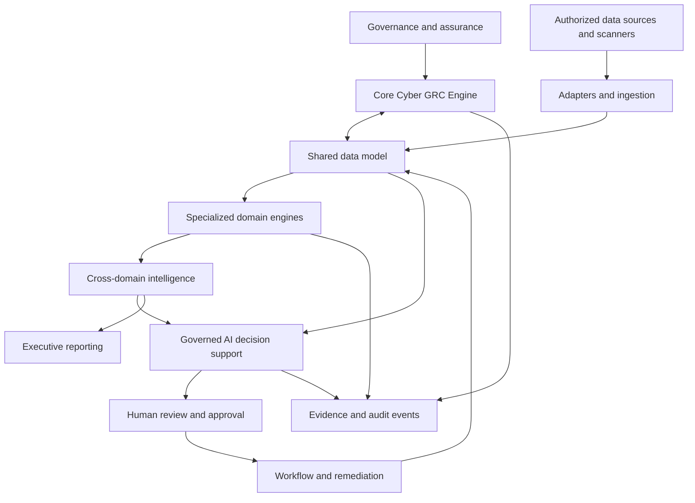

# Reference Architecture — CRISC Target Model

**Version:** R0.2 | **Status:** Conceptual target architecture  
**Canonical specification:** [CRISC-ARCH-001](architecture/CRISC-ARCH-001_REFERENCE_ARCHITECTURE_R0.1.md)

## Existing conceptual flow

```text
Public frameworks and requirements
              |
              v
Risk scenarios and control objectives
              |
              v
Assessment logic + traceable evidence
              |
              v
Validation, metrics, and audit trail
              |
              v
Human review and accountable decision
```

This remains a conceptual process, not a deployed enterprise solution.

## CRISC five-layer target

1. **Governance & Assurance:** policies, requirements, applicability, controls, ownership, audit, evidence, exceptions and approvals.
2. **Core Cyber GRC Engine:** shared data model, risk, control, evidence, workflow/remediation and audit engines.
3. **Specialized Domains:** vulnerability, threat intelligence, DLP, TPRM, IAM/SAP/SoD, cloud/OT, incident response/BCM, Data Governance/Privacy, AI Governance, AI Security, ESG and audit/compliance.
4. **Cross-Domain Intelligence:** KPI/KRI/KCI, data lineage/quality, risk aggregation, trends and executive reporting.
5. **Governed AI & Decision Support:** bounded evidence retrieval, summaries, recommendations, uncertainty disclosure, human review and auditability.



Preserve existing implementations and integrate incrementally; isolate vendor schemas behind adapters; keep scanner observations distinct from canonical vulnerabilities; make provenance/freshness/quality explicit; use deterministic rules for critical transitions; retain human authority; do not describe planned domains as implemented.

See CRISC-ARCH-001 for components, domain constraints, integration contracts and acceptance criteria.
