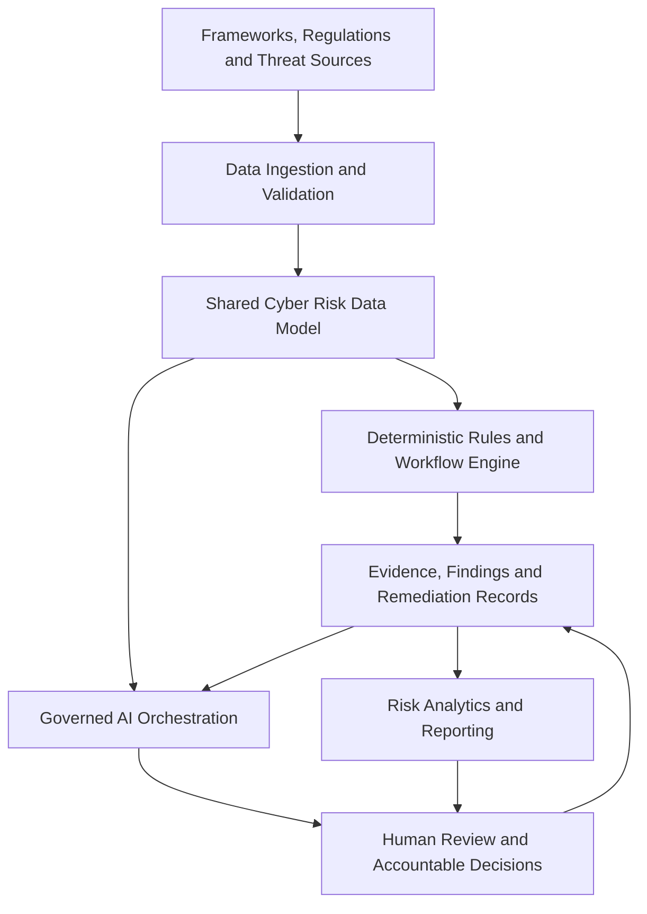

# Cyber GRC Engineering — Master Roadmap

> **Engineering secure, risk-informed, evidence-driven cybersecurity capabilities.**

**Document type:** Portfolio Master Roadmap
**Status:** Strategic plan — implementation status must be verified per project
**Language:** English
**Scope:** Cybersecurity Governance, Risk & Compliance Engineering, Security Engineering, Threat Intelligence and Responsible AI

---

## 1. Executive Vision

Cyber GRC Engineering is a portfolio of practical engineering projects designed to translate cybersecurity frameworks, risk scenarios, control objectives and threat intelligence into traceable, testable and actionable security capabilities.

The portfolio combines governance, software engineering, security controls, risk analytics, automation and responsible AI. Its objective is to demonstrate how cybersecurity requirements can be operationalized through reproducible workflows, validated data, deterministic decision logic, evidence management and accountable human decisions.

The portfolio is not presented as a deployed enterprise platform. Each project must distinguish implemented functionality from conceptual architecture, planned integrations and future capabilities.

### Strategic outcomes

- Operationalize cybersecurity frameworks and control objectives.
- Improve risk assessment, vulnerability prioritization and remediation assurance.
- Connect technical findings with business context and accountable ownership.
- Establish traceability from data sources to recommendations and decisions.
- Demonstrate secure, testable and maintainable automation.
- Apply AI to bounded, explainable and human-supervised security workflows.
- Produce evidence that supports technical validation, governance and auditability.

## 2. Portfolio Architecture

The architecture below is a target reference model. It does not imply that every layer or integration has already been implemented.

### Architecture layers

1. **Sources and integrations:** public frameworks, vulnerability advisories, approved data feeds and authorized internal or synthetic datasets.
2. **Ingestion and validation:** schema validation, data quality checks, source attribution, timestamps and error handling.
3. **Cyber risk data model:** normalized assets, findings, risks, controls, evidence, remediation plans, owners and status.
4. **Deterministic decision engine:** explicit rules for applicability, scoring, prioritization, thresholds and workflow transitions.
5. **Evidence and remediation:** persistent records, validation outcomes, accountable ownership and audit history.
6. **Analytics and reporting:** technical metrics, executive indicators, exceptions and traceable reporting.
7. **Governed AI orchestration:** bounded retrieval, contextual explanations, summaries and recommendations.
8. **Human accountability:** review, approval, risk acceptance and authorization of consequential actions.

### Architecture principles

- Security and privacy by design.
- Deterministic controls before autonomous actions.
- Explicit separation between facts, assumptions, recommendations and decisions.
- Data provenance and freshness.
- Least privilege and controlled access.
- Reproducibility and automated validation.
- Human approval for consequential actions.
- No claim of production readiness without appropriate evidence.

## 3. Portfolio Pillars

### Pillar A — Core Platform

This pillar provides the data, workflow, evidence and reporting foundations required by the other projects.

#### A1. GRC Automation & Remediation Assurance

**Status:** Existing project; functionality must be verified against the current repository.

Purpose:
- Automate GRC assessment and finding workflows.
- Maintain persistent remediation records.
- Validate corrective actions and supporting evidence.
- Preserve execution history and auditability.
- Generate analytics and dashboards.

Existing portfolio context includes Python scripts, SQLite persistence, remediation validation, analytics, dashboards and automated tests. Exact capabilities and current test results must be confirmed before publication.

#### A2. Cyber Risk Data Model

**Status:** Planned.

Purpose:
- Define common entities and relationships across the portfolio.
- Normalize assets, risks, controls, findings, evidence, owners, remediation plans and decisions.
- Establish consistent identifiers, timestamps and lifecycle states.
- Support traceable relationships between technical findings and business risk.

#### A3. Policy-to-Control-as-Code

**Status:** Planned.

Purpose:
- Map policy requirements to control objectives and validation criteria.
- Represent selected controls as machine-testable rules.
- Detect missing evidence, exceptions and unmet requirements.
- Preserve links between requirements, rules, results and evidence.

Automation must not be represented as proof of full regulatory or certification compliance.

#### A4. Risk Analytics & Integrated Reporting

**Status:** Partially supported by existing analytics and dashboards; cross-project integration is planned.

Purpose:
- Consolidate validated findings and risk indicators.
- Measure remediation status, overdue actions and evidence completeness.
- Separate operational metrics from executive indicators.
- Display source, reporting period, definitions and limitations.

---

### Pillar B — Security Capabilities

This pillar applies the core platform to concrete cybersecurity domains.

#### B1. Intelligent Vulnerability Management

**Status:** Roadmap documented; staged implementation planned.

Purpose:
- Normalize vulnerability findings and asset context.
- Track severity, ownership, remediation plans and SLA status.
- Distinguish open, in-treatment, overdue, blocked and remediated findings.
- Preserve evidence of validation and closure.
- Produce traceable technical and executive reporting.

Target capabilities:
- Import and validate vulnerability data.
- Correlate findings with authorized asset inventory.
- Monitor remediation SLAs and missing action plans.
- Integrate threat intelligence into risk-based prioritization.
- Expose controlled data and tools to governed AI workflows only after core logic is validated.

#### B2. Threat Intelligence & Risk Prioritization Lab

**Status:** Planned — new roadmap initiative.

**Objective:** Transform public and authorized cyber threat intelligence into contextualized, explainable and traceable security priorities.

Initial scope:
- Import public vulnerability and exploitation data.
- Preserve source, collection time, identifiers and references.
- Normalize CVEs, severity and exploitation indicators.
- Use CISA Known Exploited Vulnerabilities (KEV) data as one prioritization signal.
- Map relevant adversary behaviors to MITRE ATT&CK when supported by evidence.
- Correlate vulnerability records with synthetic or authorized asset context.
- Generate deterministic prioritization with explicit reasons.
- Produce a traceable report containing source, freshness, rule version and recommended action.

Initial technology:
- Python.
- SQLite.
- REST APIs or validated public data files.
- Automated tests.
- GitHub Actions where appropriate.
- Markdown reports and reproducible synthetic examples.

Initial exclusions:
- No unauthorized scanning.
- No offensive exploitation capability.
- No production asset integration without explicit authorization.
- No claim that a vulnerability is actively exploited unless the selected source supports that conclusion.
- No prioritization based exclusively on CVSS.

The initial implementation should use transparent rules combining available threat evidence, asset criticality, exposure context and remediation requirements. Missing information must remain explicit rather than being silently inferred.

#### B3. IAM Risk Engineering

**Status:** Planned.

Purpose:
- Model identity-related risks and control objectives.
- Assess excessive privileges, segregation-of-duties conflicts and access review evidence.
- Represent identity lifecycle and access governance controls.
- Support traceable findings and remediation workflows.

Relevant portfolio connection: SAP Security Lab and SAP GRC SoD Lab, subject to verification of their actual implementations.

#### B4. DevSecOps & API Security

**Status:** Planned.

Purpose:
- Integrate security checks into software delivery workflows.
- Assess API authentication, authorization, input validation and exposure risks.
- Define security gates and exception handling.
- Demonstrate repeatable testing and remediation evidence.

Potential references include OWASP API Security Top 10 and relevant secure development guidance.

#### B5. Cloud Configuration & Risk Assurance

**Status:** Planned.

Purpose:
- Model cloud configuration risks and security control objectives.
- Evaluate synthetic configuration examples against explicit rules.
- Track exceptions, evidence and corrective actions.
- Map selected findings to relevant frameworks.

Cloud provider integrations and production assessments require separate scope definition and authorization.

#### B6. Incident Response & Resilience

**Status:** Planned.

Purpose:
- Model incident lifecycle, severity, ownership and escalation.
- Connect incident records with risks, affected assets and controls.
- Track response actions, evidence and lessons learned.
- Demonstrate response metrics and resilience-oriented reporting.

Initial demonstrations should use fictional incidents and synthetic data.

---

### Pillar C — AI & Autonomous Assurance

This pillar introduces AI into bounded, traceable and human-supervised workflows.

#### C1. AI Asset Inventory & Shadow AI Governance

**Status:** Planned.

Purpose:
- Define an inventory model for AI systems and use cases.
- Record business owner, purpose, data categories, provider and risk classification.
- Identify governance gaps and unapproved-use indicators where supported by authorized evidence.
- Connect AI inventory records to policy requirements and risk assessments.

The project must distinguish observed evidence from inferred or user-declared information. It must not imply visibility into an organization's AI usage without an authorized data source.

#### C2. AI Risk & Control Assessment

**Status:** Planned.

Purpose:
- Map AI use cases to risk scenarios and control objectives.
- Assess governance, privacy, security, transparency and human oversight.
- Record evidence, exceptions, recommendations and accountable decisions.
- Demonstrate traceable assessments against selected AI governance frameworks.

#### C3. Agentic GRC Orchestrator

**Status:** Planned.

Purpose:
- Retrieve authorized portfolio records through controlled interfaces.
- Explain findings and risk prioritization using traceable evidence.
- Detect overdue SLAs and missing remediation plans.
- Prepare notifications and recommendations for accountable teams.
- Require authorization before consequential actions.
- Preserve tool calls, decisions, outcomes and relevant audit records.

The orchestrator must not replace the deterministic rules engine or assume authority to accept business risk. AI output must be distinguishable from verified source data and approved decisions.

## 4. Frameworks and Authoritative References

The following references provide a foundation for selected portfolio projects. Their inclusion does not, by itself, establish compliance or certification.

| Domain | Framework or reference | Intended application |
|---|---|---|
| Cybersecurity risk | NIST Cybersecurity Framework 2.0 | Governance and cybersecurity risk outcomes |
| Security governance | COBIT 2019 | Governance objectives and management practices |
| Information security | ISO/IEC 27001 | Information security management requirements |
| Security controls | ISO/IEC 27002 | Information security control guidance |
| Risk management | ISO/IEC 27005 | Information security risk management |
| Security governance | ISO/IEC 27014 | Governance of information security |
| Privacy | ISO/IEC 27701 | Privacy information management |
| AI governance | ISO/IEC 42001 | AI management system requirements |
| AI risk | NIST AI RMF | AI risk management |
| Adversary behavior | MITRE ATT&CK | Tactics and techniques mapping |
| Threat intelligence | STIX 2.1 / TAXII 2.1 | Structured representation and exchange of threat intelligence |
| Vulnerability prioritization | CVE / CVSS | Vulnerability identification and technical severity |
| Exploitation evidence | CISA KEV Catalog | Known-exploited vulnerability signal |
| Application security | OWASP Top 10 and API Security Top 10 | Application and API risk analysis |
| AI security | OWASP guidance for LLM applications and agentic systems | AI application and agent security |
| AI threat modeling | MITRE ATLAS | Adversarial threats to AI-enabled systems |
| Internal controls | SOX / ITGC | Relevant IT general controls and audit scenarios |
| Internal control | COSO | Internal control and enterprise risk context |
| Assurance reporting | ISAE 3402 | Service organization controls assurance context |
| Data management | DAMA-DMBOK | Data governance and management concepts |
| Brazilian privacy regulation | LGPD | Personal data protection obligations where applicable |

### Reference governance

Each project must identify the specific version, publication or official source used. Control mappings must be explicit about scope and interpretation. Where a standard is copyrighted or requires licensed access, the portfolio should reference it appropriately rather than reproduce protected content.

## 5. Implementation Roadmap

Implementation is dependency-driven. Planned phases do not imply that work has started or that a target capability is operational.

### Phase 1 — Stabilize the Core Platform

Priorities:
1. Review the current GRC Automation Lab and its automated tests.
2. Confirm remediation persistence, validation and audit history.
3. Document the existing data model and limitations.
4. Establish shared identifiers and data-quality conventions.
5. Validate existing analytics and dashboards.
6. Publish the Master Roadmap and align the README with verified project status.

**Exit criteria:** reproducible tests, documented architecture, clear limitations and traceable remediation behavior.

### Phase 2 — Risk Data and Threat-Informed Vulnerability Management

Priorities:
1. Define the vulnerability and asset data model.
2. Implement validated imports using public or synthetic data.
3. Create the Threat Intelligence & Risk Prioritization Lab.
4. Implement deterministic prioritization rules.
5. Add SLA monitoring and remediation tracking.
6. Test provenance, freshness, error handling and reporting.

**Exit criteria:** reproducible input data, documented rules, automated tests and reports with traceable reasons for prioritization.

### Phase 3 — Identity, Policies and Engineering Security

Priorities:
1. Develop the Cyber Risk Data Model further.
2. Define Policy-to-Control-as-Code conventions.
3. Extend IAM and segregation-of-duties risk demonstrations.
4. Develop DevSecOps and API security examples.
5. Add synthetic cloud configuration assessments.

**Exit criteria:** testable controls, documented mappings, reproducible results and explicit exception handling.

### Phase 4 — Incident Response and Integrated Assurance

Priorities:
1. Model incident lifecycle and response evidence.
2. Connect incident scenarios to assets, risks and controls.
3. Consolidate validated indicators across projects.
4. Define consistent reporting periods and metric semantics.
5. Demonstrate traceable executive reporting.

**Exit criteria:** consistent data definitions, reproducible reports and traceability to source records.

### Phase 5 — AI Governance and Controlled Orchestration

Priorities:
1. Define AI inventory and Shadow AI governance records.
2. Implement selected AI risk and control assessments.
3. Expose read-only, bounded interfaces to validated portfolio data.
4. Add evidence-grounded explanations and recommendation generation.
5. Require authorization for consequential actions.
6. Validate auditability, failure handling and human oversight.

**Exit criteria:** explicit boundaries, validated data access, tests for expected behavior and documented approval requirements.

## 6. Engineering and Quality Standards

Every project must follow the portfolio standards defined in `docs/PORTFOLIO_STANDARDS.md`.

Each project should include:
1. Problem statement and intended audience.
2. Scope, assumptions and explicit limitations.
3. Architecture or process flow.
4. Synthetic data or safe reproducible examples.
5. Validation steps and tests where applicable.
6. Risks, human approval points and audit trail considerations.
7. References to authoritative public sources.

Additional engineering expectations:
- Validate input schemas and reject invalid data safely.
- Use deterministic rules for critical scoring and workflow transitions.
- Separate application logic from persistence and reporting where appropriate.
- Handle missing, stale or contradictory data explicitly.
- Preserve meaningful timestamps and source references.
- Test boundary conditions, error cases and invalid transitions.
- Use version control and review `git diff` before commits.
- Never publish credentials, secrets, proprietary evidence or unauthorized production data.

## 7. Security, Privacy and Responsible AI

### Security by design
Apply least privilege, input validation, secure configuration, dependency review and explicit trust boundaries.

### Privacy by design
Minimize personal data and use synthetic identifiers in demonstrations. Do not publish personal data or confidential company information without authorization.

### Responsible AI
- Ground generated explanations in retrievable evidence.
- Separate source facts from model-generated summaries and recommendations.
- Preserve uncertainty and disclose missing information.
- Do not allow AI to independently accept business risk.
- Require authorization for consequential actions.
- Maintain audit records proportionate to the action and risk.
- Test failure cases, prompt injection risks and unauthorized data access for AI-enabled components.

### Human accountability
The appropriate accountable owner remains responsible for risk acceptance and consequential business decisions. Automation can support assessment and prepare actions but must not silently transfer accountability to an AI system.

## 8. Metrics and Evidence

Metrics should be introduced only when the underlying data and calculation are validated.

Potential indicators include:
- Automated test pass rate.
- Data validation failure rate.
- Findings by severity and remediation status.
- Overdue remediation items and SLA compliance.
- Evidence completeness and validation outcomes.
- Percentage of priorities with documented rationale.
- Source freshness and ingestion failures.
- AI recommendations reviewed, accepted, rejected or escalated.
- Audit trail completeness.

Every metric must define its numerator, denominator, time period, source and known limitations. Do not publish illustrative numbers as actual operational performance.

## 9. Definition of Done

A project is ready to be presented as implemented only when its claims are supported by the repository.

Minimum criteria:
- Scope and limitations are documented.
- Architecture or workflow is described.
- Source code and example data are available where applicable.
- Tests or validation steps can be reproduced.
- Results and known limitations are recorded.
- Relevant references are included.
- Security and privacy checks have been considered.
- README status and evidence links reflect the actual implementation.

Use the following status definitions consistently:

- **Implemented:** functionality exists in the repository.
- **Validated:** relevant tests or verification steps have been executed successfully.
- **In Progress:** implementation has started but is incomplete.
- **Planned:** approved as a roadmap objective, not yet implemented.
- **Conceptual:** architecture or idea only; no operational implementation is claimed.

## 10. Scope Boundaries and Non-Goals

This portfolio demonstrates engineering methods and security governance concepts. It does not claim to replace enterprise GRC, SIEM, IAM, vulnerability management, CSPM or threat intelligence platforms.

The portfolio will not:
- Claim production integrations without evidence.
- Claim full compliance based only on framework mappings.
- Publish confidential corporate data or internal audit evidence.
- Execute unauthorized scans or offensive actions.
- Delegate risk acceptance to AI.
- Present synthetic results as real enterprise metrics.
- Describe conceptual diagrams as deployed architecture.

## 11. Repository Governance and Navigation

The repository's actual structure is authoritative. Documentation must not imply that directories, integrations or capabilities exist before they are created and validated.

Current documentation references:
- `docs/ARCHITECTURE.md` — existing conceptual reference architecture.
- `docs/PORTFOLIO_STANDARDS.md` — project definition of done, security and privacy rules, and documentation language.
- `README.md` — portfolio entry point and project navigation.

Existing project directories include GRC automation, AI cyber risk governance, cyber GRC risk register, cybersecurity research, SAP GRC SoD and SAP security. Their implementation status must be checked individually before being described as complete.

The Master Roadmap serves as the strategic reference for portfolio sequencing. Project-specific READMEs remain responsible for implementation details, execution instructions, tests and evidence.

---

**Guiding principle:** Build verifiable security capabilities first, connect them through traceable risk data, and introduce AI only where its role, authority and limitations are explicit.
