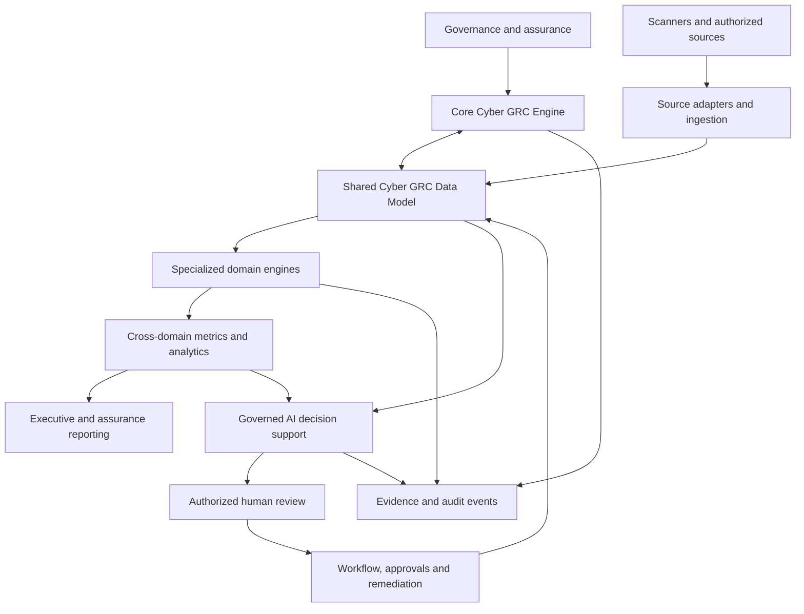

# CRISC-ARCH-001 — Reference Architecture

**Version:** R0.1 | **Status:** Draft — Technical Review Required  
**Related:** CRISC-DATA-001, CRISC-MAP-001, CRISC-VM-001

## Purpose

Define a target architecture for integrated Cybersecurity GRC, Audit, Vulnerability Management, TPRM, DLP, IAM, Data Governance, Privacy, Business Resilience, AI Governance, AI Security and ESG Assurance. It connects assets, suppliers, AI systems, requirements, controls, evidence, findings, remediation, metrics and accountable decisions.

## Principles

- Evidence, provenance and freshness before assertion.
- Business-contextual risk; technical severity is only one input.
- Deterministic, testable and versioned rules for critical decisions.
- Human accountability for risk acceptance and consequential actions.
- Shared identifiers/contracts without erasing domain semantics.
- Vendor/scanner-agnostic adapters.
- Incremental integration; preserve existing working code.
- Explicit maturity distinctions: conceptual, planned, implemented, validated.

## Five-layer target architecture

1. **Governance & Assurance:** policies, requirements, applicability, controls, ownership, audit scope, evidence, exceptions and approvals.
2. **Core Cyber GRC Engine:** Shared Data Model, Risk, Control/Requirement, Evidence, Workflow/Remediation and Audit/Event engines.
3. **Specialized Domains:** Cyber Risk/Vulnerability; Threat Intelligence; DLP; TPRM; IAM/IGA/PAM and SAP SoD; Cloud/OT; Incident Response/BCM; Data Governance/Privacy; AI Governance; AI Security; ESG; Audit/Compliance.
4. **Cross-Domain Intelligence:** KPI/KRI/KCI definitions/observations, metric lineage, risk aggregation, data quality, trends, concentration analysis and executive reporting.
5. **Governed AI & Decision Support:** bounded retrieval, evidence-grounded summaries, explainable recommendations, uncertainty disclosure, human review and auditability.

## Core engines

| Engine | Responsibility | Boundary |
|---|---|---|
| Shared Data Model | Canonical entities, IDs, relationships, lifecycle | Preserve domain distinctions |
| Risk | Inherent/residual context, scoring, aggregation, rationale | Scanner severity is not enterprise risk |
| Control | Requirement mapping, applicability, assessment | Mapping alone is not compliance proof |
| Evidence | Provenance, validity, metadata, controlled references | No confidential artifacts in public repo |
| Workflow | Remediation, exceptions, approvals, state transitions | No autonomous risk acceptance |
| Audit | Actor, timestamp, action, target, change context | No tamper-proof claim without controls |
| Metrics | KPI/KRI/KCI definitions, observations, thresholds, lineage | No unvalidated metrics |
| Governed AI | Evidence-grounded assistance, bounded recommendations | Does not replace rules or accountable owners |

## Domain constraints

Vulnerability: separate canonical issue from scanner observation; retain source/time/raw values; version correlation and severity rules. TPRM: distinguish supplier, service, assessment, contract, fourth party and concentration. DLP: distinguish telemetry event, policy violation, investigation and incident. Data Governance: distinguish data asset, owner/steward, classification, lineage, quality rule and observation. AI Governance: inventory, use case, purpose, owner, risk assessment and oversight. AI Security: threat model, attack surface, security assessment and control, distinct from AI management governance. ESG: preserve methodology, reporting boundary, source evidence, estimation status and assurance limitations. Resilience: connect process, BIA, dependencies, recovery objectives, exercise, incident and remediation.

## Repository baseline and limits

Current repository contains GRC Automation Lab (Python/SQLite/remediation history/analytics/tests), a CSV/browser vulnerability dashboard, a starter Python Risk Register and synthetic SAP GRC SoD analyzer. AI Cyber Risk Governance, SAP Security and Cybersecurity Research are planned/conceptual. TPRM, DLP, Data Governance, ESG, AI Security, shared physical data model and scanner connectors are not claimed as implemented.

This is a logical reference architecture, not a physical deployment design. Database, event transport, identity provider, hosting, retention, HA, service ownership and production integration require separate decisions.

## Acceptance criteria

Preserve existing files/behavior; define each entity, owner, ID and lifecycle; document provenance/security/error handling; add synthetic fixtures/tests; align maturity claims with evidence; exclude confidential/production data.

**Change log:** R0.1 establishes five-layer target architecture, shared engines, specialized domains, cross-domain intelligence and governed AI.
