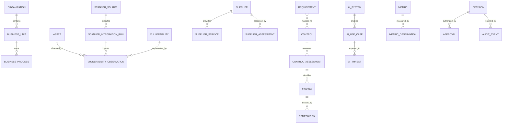

# CRISC-DATA-001 — Shared Cyber GRC Data Model

**Version:** R0.1 | **Status:** Draft — Logical Model / Technical Review Required  
**Parent:** CRISC-ARCH-001 | **Related:** CRISC-MAP-001, CRISC-VM-001

## Scope

Conceptual/logical vocabulary for shared Cyber GRC domains. Not a physical SQL schema, migration plan, API contract or claim that every entity is implemented.

## Modeling rules

Separate objects from observations/assessments; preserve source-native and normalized values; use stable internal IDs and source-scoped external IDs; preserve history; distinguish event time from ingestion time; keep missing/stale/ambiguous data explicit; separate evidence metadata from controlled artifact bytes.

## Canonical entities

| Domain | Entities |
|---|---|
| Organization/business | Organization, BusinessUnit, BusinessProcess |
| Asset/data | Asset, DataAsset |
| Supplier | Supplier, SupplierService, SupplierAssessment, FourthParty |
| Risk | Risk, RiskAssessment |
| Requirements/controls | Requirement, Control, ControlAssessment |
| Assurance | Finding, Evidence, Remediation, Exception |
| Vulnerability | Vulnerability, VulnerabilityObservation, VulnerabilityCorrelation, ScannerSource, ScannerConnector, ScannerIntegrationRun |
| Incident/telemetry | Incident, SecurityEvent |
| DLP | DLPEvent, PolicyViolation, Investigation |
| AI | AI_System, AIUseCase, AIThreat, AISecurityAssessment, AIControl |
| Metrics | Metric, MetricObservation, MetricThreshold |
| Decision/audit | Decision, Approval, AuditEvent |

## Semantic separations

Risk vs RiskAssessment = scenario vs dated evaluation. Requirement vs Control = obligation vs mechanism. Control vs ControlAssessment = definition vs assessment for a scope/period. Finding vs Vulnerability = assessed gap vs technical weakness. Vulnerability vs VulnerabilityObservation = canonical issue vs scanner-specific asset/time observation. Incident vs SecurityEvent = event may contribute to incident but is not automatically one. DLPEvent vs PolicyViolation = telemetry vs policy outcome. Evidence metadata vs artifact = reference vs controlled bytes. Metric vs MetricObservation = definition vs value. Recommendation vs Decision = generated advice vs accountable approval. AI Governance vs AI Security = management governance vs technical security assurance.

## Relationship guidance

Organization 1:N BusinessUnit; BusinessUnit 1:N BusinessProcess; Asset 1:N VulnerabilityObservation; ScannerSource 1:N ScannerIntegrationRun; Run 1:N VulnerabilityObservation; many observations may support one canonical vulnerability; Supplier 1:N SupplierService/SupplierAssessment; Requirement N:M Control through versioned applicability mapping; Control 1:N ControlAssessment; assessments identify Findings and reference Evidence; Finding 1:N Remediation history; AI_System 1:N AIUseCase; AIUseCase links AIThreat/AISecurityAssessment; Metric 1:N MetricObservation/MetricThreshold; Decision links Approval/AuditEvent.

## Vulnerability observation requirements

Retain observation ID, source ID, run ID, source-native finding ID, source asset identifier, resolved CRISC Asset ID when confidence permits, observed/ingestion timestamps, raw severity/score, CVSS version/score where present, plugin/test ID, CVE where present, raw record reference, normalized values and rule versions.

IP alone is not a stable asset key. Ambiguous correlation requires review. Absence from a later scan is not proof of remediation.

## Common governance fields

Where applicable: internal ID, source-scoped external ID, business scope, owner, timestamps/actor, source/schema version, observation time, lifecycle/history, classification, retention/access restrictions, quality status, methodology/rule version, evidence/decision/audit links.

## Conceptual ERD

Illustrative ERD only; physical schema and exact optionality/cardinality require further design.

## Current implementation caveat\n\nThe GRC Automation Lab currently has both a finding-linked remediation lifecycle (\`remediation_cases\` / \`remediation_events\`) and a separate register/history implementation (\`remediation_records\` / \`remediation_history\`). They are not interchangeable and are not yet reconciled to one physical canonical schema. See [CRISC-MAP-002](CRISC-MAP-002_GRC_FIELD_TO_CANONICAL_MAPPING_R0.1.md). Evidence CSV records are submission/expiry metadata; artifact storage and integrity metadata are not established by those rows.\n\n## Physical design gates

Before SQL/migrations: inventory current SQLite schemas/data access; map columns/keys; define PK/FK, uniqueness/idempotency; define history/migration strategy; define classification/retention/access; add migration/backward-compatibility tests; prove existing GRC behavior/data remain intact.

**Change log:** R0.1 establishes shared logical entities, semantic separations, relationship guidance, vulnerability provenance and physical-design gates.
